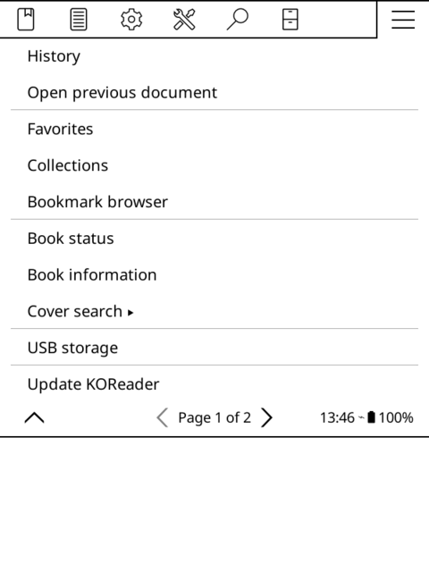

# Cover Search for KOReader

Cover Search lets you choose a different cover for the book you're reading in KOReader. It brings together covers from **Open Library, Apple Books, Goodreads, Amazon, and OverDrive**, so you can browse different editions without looking through each site yourself. Every thumbnail shows the source and the image's actual resolution to help you choose a cover that will look good on your screen.

The selected cover is saved as a KOReader cover override, which is used in its book browser and book-cover sleep screen. Your ebook's embedded cover stays as it is, and you can restore it from the plugin menu at any time. On a Kindle, this won't change the thumbnail on the Kindle home screen.

*Recorded in KOReader's desktop emulator.*

## Installation

The plugin targets KOReader **v2026.07.1** and needs an internet connection to search and download covers. There are no accounts to set up, API keys to obtain, or extra dependencies to install.

1. Download `koreader-coversearch-vX.Y.Z.zip` from the [latest release](../../releases/latest) and extract it into KOReader's `plugins` directory. The resulting path should be `koreader/plugins/coversearch.koplugin/main.lua`.
2. Restart KOReader, then open a book.
3. Open the top menu's **hamburger (☰) tab**. You'll find **Cover search** immediately below **Book information**.

If the entry doesn't appear, check that **Cover search** is enabled in KOReader's plugin management menu and restart again. You can also install directly from this repository by copying the `coversearch.koplugin` folder into `koreader/plugins`.

## Choosing a cover

Choose **Cover search → Search covers for this book**. The plugin fills in the title and author from the book's metadata; you can edit either before searching. If it finds a valid ISBN, it also checks **Use ISBN …**. Leave that checked to search using the ISBN, or uncheck it to look for other cover designs by title and author. Sources may still return covers from other editions, and Apple Books always searches by title and author.

If the book contains several different ISBNs, **Choose ISBN** lets you select which one to use. The checkbox shows the current selection; choosing another ISBN keeps your title and author edits. Equivalent 10- and 13-digit numbers count as one choice.

Both 10- and 13-digit ISBNs are supported, including identifiers embedded by calibre. If a source finds no cover candidates for the chosen ISBN, the plugin tries its equivalent 10- or 13-digit number once, when one exists. An unavailable or blocked source won't trigger that extra request.

Select **Search** to open the cover browser. Results from different sources are mixed together, with **Previous** and **Next** below the thumbnails. Tap a cover for a larger view, then use **Preview** to see it full screen or **Details** to read its source information. When you've found one you like, select **Use this cover**.

While a search or download is running, you can **tap anywhere to cancel**, or press any key on a device with keys. Cancelling a page download leaves you on the page you were browsing. Downloaded images are cached for as long as the browser stays open, so pages still in the cache open immediately when you return to them. Closing the browser clears that temporary cache.

Devices without touch input have numbered buttons for opening covers. If you'd like quicker access to the plugin, you can assign **Search book covers** to a gesture or shortcut in KOReader's action settings.

To go back to the embedded cover, choose **Cover search → Restore original cover** and confirm. This removes the current KOReader cover override, including one you may have set outside this plugin.

## Preferences

The **Cover search** menu also contains the search preferences. All five sources are enabled initially; open **Sources** to turn individual catalogs on or off. **Results per source** controls how many candidates each catalog contributes, with a choice of 3, 5, or 10 and a default of 3. Under **Store regions**, you can change the Apple Books country and Amazon store from their defaults of US and amazon.com.

English and Spanish are included, and the plugin follows KOReader's own language setting. To use Spanish, choose **Español** under **Settings → Language** and restart when prompted. For other UI languages, the plugin's text falls back to English.

## If you can't find a suitable cover

Try shortening the title, checking the author's spelling, or turning off the ISBN filter to include other editions. The **Summary** button in the cover browser shows which sources returned results and which encountered an error. If a catalog is temporarily unavailable, you can continue with the others or disable it in **Sources**. Images that fail to download appear as unavailable tiles.

If your chosen cover doesn't appear while the device is asleep, check that KOReader's sleep screen is set to show the book cover. Its **Full stretch** setting will fill the screen without bars, although covers with different proportions will be stretched.

## Contributing

See [DEVELOPMENT.md](DEVELOPMENT.md) for tests, translations, releases, and recording the demo. [TESTING.md](TESTING.md) contains verification results and the device test checklist. GitHub Actions builds the release ZIPs and prepares drafts for review before publication; each release links to its source commit and build log and includes a SHA-256 checksum.

## License

[AGPL-3.0-or-later](LICENSE).
